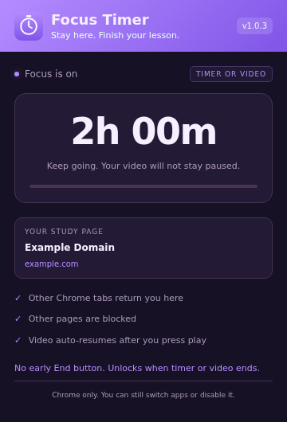

# Focus Timer

A personal Chrome extension for staying on one study page and keeping a lesson video playing.

## What it does
- Choose a 1-hour or 2-hour focus session.
- Stay on the exact study page. Switching tabs or Chrome windows returns you to it.
- Keep HTML5 videos playing after the first play, with pause prevention and auto-resume.
- End focus when the timer or the playing video ends, whichever happens first.
- Show remaining time in the popup. No early End button or floating overlay.

Settings stay in your Chrome profile. No accounts, analytics or uploads.

## Install
1. Download this repository as a ZIP and unzip it.
2. Open `chrome://extensions` in desktop Chrome.
3. Turn on **Developer mode**.
4. Click **Load unpacked** and select the folder containing `manifest.json`.
5. Pin Focus Timer. Open a study page and click the icon to start.

Right-click the icon and choose **Options** to select 1 hour or 2 hours. To update, replace the folder files and click **Reload** on the extension card.

## Limits
This is a self-control aid, not an unbreakable device lock. It cannot stop other apps, browsers or Chrome profiles. `chrome://extensions` remains available to disable it. Incognito is not covered unless you allow it.

Video behavior varies by player, buffering and Chrome autoplay rules. Seeking is not blocked. The specific PW/Penpencil lesson has not been directly tested. Native Split View separation requires Chrome 155 or later.

Other tabs are kept open, not closed. Blocked pages do not automatically return to their previous URLs when focus ends. Closing the study tab ends focus.

## Permissions
Uses local storage, alarms, tab selection, HTTP/HTTPS access, navigation rules and script injection to enforce focus and video controls. The current study URL, title and deadline are saved locally; browsing history and media are not uploaded.

Version 1.0.3. Personal project, still being tested across sites.
